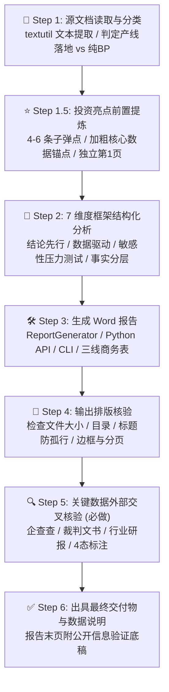
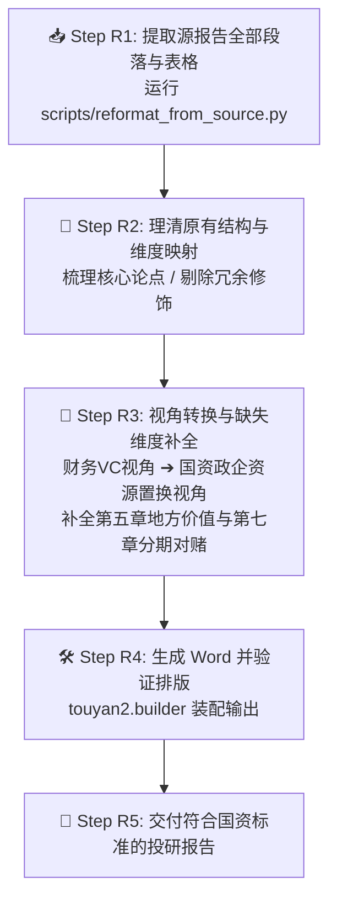

# touyan2 — 产线落地投研分析引擎

<p align="center">
  <strong>面向地方政府招商引资、经开区管委会与国资产业引导基金的结构化投研评估引擎</strong>
</p>

<p align="center">
  <a href="https://github.com/zhangpelf/touyan2"></a>
  <a href="https://github.com/zhangpelf/touyan2/blob/main/LICENSE"></a>
  <a href="https://github.com/zhangpelf/touyan2/actions"></a>
  <a href="https://github.com/zhangpelf/touyan2/pulls"></a>
  <a href="https://github.com/zhangpelf/touyan2"></a>
</p>

---

## 📖 项目定位：为什么需要 touyan2？

当地方招商部门、高新技术园区管委会或国资产业引导基金拿到一份企业的《商业计划书》（BP）或《产线投资方案》时，常常面临以下核心痛点：

1. **企业自述水分大**：申报材料充斥着“国际领先”、“千亿蓝海”、“行业第一”等定性修饰词，缺少真实的固定资产投资明细、工程良率与锁定在手订单证据；
2. **诉求失衡与对赌落空**：项目方常索要大额厂房代建免租、设备购置补贴及政府引导基金跟投，但承诺的税收产值缺乏科学测算，地方政府面临政策被套取、国有资产流失的被动局面；
3. **缺少标准化的研判抓手**：传统财务 VC 关注未来估值倍数与 IPO/并购退出，而国资招商看重**强链补链、固投真实性、能耗环境指标、亩均税收对赌与清算回收保障**；
4. **材料杂乱无法直接呈报**：从企业分散的 PPT、草拟投资方案到形成一份符合体制内/国资审阅规范的 Word 报告，需要耗费大量排版与数据核验工时。

**`touyan2`（投研2）** 应运而生。它是一个**产线落地投研分析框架与自动化文档生成引擎**。通过**7 维全景评估模型**，将杂乱的企业申报材料剥离重组，快速生成一份**结论先行、数据驱动、风险显式、符合国资政企公文级排版标准**的完整投研分析报告（`.docx`）。

---

## 🔄 双模端到端核心工作流 (Complete Workflow Engine)

`touyan2` 内置两套标准化工作流，覆盖新项目入库评估与既有报告格式转换两大核心场景：

### 模式一：新项目评估标准闭环（企业 BP → 落地投研报告）



#### 详细执行步骤：

- **Step 1：源文档读取与分类**
  - **文本提取命令**（支持 `.docx` 与 `.doc`）：
    ```bash
    textutil -convert txt -stdout "<企业申报材料.docx>" > /tmp/input_text.txt
    ```
  - **文档类型判定**：
    - **产线落地类**（含投资总额、厂房面积、建设周期、政策支持与基金诉求）$\to$ 走完整 7 章国资投研流程；
    - **纯轻资产商业计划书**（侧重软件算法或商业模式，无厂房落地诉求）$\to$ 走简化版技术与市场评估。

- **Step 1.5：核心投资亮点前置提炼（必做）**
  - 在进入详细章节前，提炼 **4-6 条投资亮点**，置于封面后的独立第 1 页；
  - 格式严格遵循：`● **加粗标题**：核心量化数据锚点 + 一句话事实支撑`；
  - 第一条必须是**行业地位、市场规模或核心性能指标锚点**。

- **Step 2：7 维度全景框架结构化分析**
  - 严格遵守“结论先行、数据说话、证据分层”规范，分别完成 7 个维度的定量与定性剖析（详见下文章节体系）。

- **Step 3：生成 Word 报告**
  - 将分析数据填入 `ReportContent` 容器，通过 `touyan2` 引擎或 CLI 生成符合公文排版规范的 `.docx` 文件。

- **Step 4：输出排版核验**
  - 检查文件有效性（大小 $\ge 30\text{KB}$），核对封面、目录、免责声明、表格三线表及“与下段同页”防孤行配置。

- **Step 5：关键数据外部公开信息交叉核验（必做核心）**
  - **绝不直接采信项目方单方陈述**。针对企业自述的成立时间、实缴资本、历史融资、核心客户、诉讼记录，进行外部穿透查验；
  - **四态核验标记**：
    - ✅ **已验证**：公开权威渠道可查且与 BP 一致；
    - ⚠️ **部分吻合**：数据存在微小差异或轮次名称不一致，注明差异；
    - ❌ **有出入**：公开信息与 BP 矛盾，**必须在正文中强制修正并附说明**；
    - ❓ **无法验证**：属于内部机密或早期项目，正文严格标注「*项目方声称，待尽调确认*」。

- **Step 6：出具最终报告与数据说明**
  - 报告最后一页自动追加《数据核查与公开信息交叉说明》，实现证据链闭环。

---

### 模式二：已有投研报告重构重组（已有报告 → touyan2 格式）

适用场景：已有初步投研材料（如二级市场研报、财务 VC 尽调、咨询报告等），需快速转为地方政府/国资招商落地规范报告。



#### 重构核心工具与要点：
1. **运行提取工具**：
   ```bash
   python3 scripts/reformat_from_source.py \
     --source "/path/to/源报告.docx" \
     --company "目标企业全称" \
     --output "/path/to/内容提取与映射模板.txt"
   ```
2. **视角转换原则**：
   - 将财务 VC 的“估值多少倍、何时 IPO 退出”转换为国资关注的“**真实固投多少、需代建多少厂房、投资回收期多长**”；
   - **必做增值补全**：财务研报通常缺失第五章（地方落地价值）与第七章（分期投资建议与对赌协议），必须根据源报告论证推导补写。

---

## ⚖️ 与普通投研（财务 VC / 二级市场）的分工界限

| 比较维度 | 普通二级市场 / 财务 VC 投研 | touyan2 产线落地投研引擎 |
| :--- | :--- | :--- |
| **主要目标客群** | 股票二级投资者、公募/私募基金经理 | 地方政府招商引资局、开发区管委会、国资引导基金 |
| **输入材料** | 上市公司公告、财务报表、行业研报、Wind 数据 | 企业《商业计划书》(BP)、产线落地申请、要素诉求清单 |
| **研判核心指标** | 市盈率 (P/E)、未来市值空间、IRR 回报率 | **固定资产投资真实性、亩均产值与税收、能耗排放、就业带动** |
| **退出与保障机制** | 二级市场抛售退出、IPO 申报对赌 | **厂房回购、土地使用权收回、亩均税收对赌追缴 (Clawback)** |
| **输出成果格式** | Markdown 研报、PDF、PPT 路演材料 | 严谨合规、符合体制内阅读审阅标准的 Word 报告 (`.docx`) |
| **最终决策结论** | 买入 / 增持 / 中性 / 卖出建议 | **建议引进落地 / 审慎附条件推进 / 暂缓或不推荐** |

---

## 📚 7 维全景评估章节体系

| 章节 | 核心研判任务 | 必备核心表格与量化输出 | 核心风控关注点 (Red Flags) |
| :--- | :--- | :--- | :--- |
| **第一章 项目概览** | 厘清谁在投资、投向何处、自筹比例 | 投资亮点前置、基本信息表、投资分期表、资金用途拆解表 | ⚠️ 总投虚高、自有出资低于 30%、重度依赖政府垫资 |
| **第二章 行业与市场分析** | 检验赛道天花板与真实市场需求 | 市场规模预测表 (CAGR)、产业链竞争格局矩阵表 | ⚠️ 产能过剩赛道新扩产能、引用不可信数据虚夸占有率 |
| **第三章 项目竞争力评估** | 考察核心技术护城河与供应链掌控 | SWOT 优劣势矩阵、核心产品技术参数横向对标表 | ⚠️ 核心专利职务发明争议、关键元器件进口断供、代工改标 |
| **第四章 财务效益分析** | 审慎测算投资回收期与抗风险韧性 | 分期产值与效益测算表、核心变量敏感性分析表 | ⚠️ 忽视爬坡期亏损、盲目乐观毛利率、缺乏压力测试 |
| **第五章 地方落地价值** | 锚定税收产出、拉动就业与强链补链 | 亩均税收/产值考核表、政策诉求与谈判应对表 | ⚠️ 亩均税收不达园区门槛、高能耗/危废无排放指标 |
| **第六章 风险分析与缓释** | 显式列出全流程风险并配备防御抓手 | 关键风险清单与缓释措施表（技术/市场/履约/政策） | ⚠️ 拿完补贴撤退迁址、大客户回款账期过长拖垮现金流 |
| **第七章 综合评估与建议** | 明确决策结论（推进/审慎/否决） | 综合研判评分卡、分期投资里程碑表、尽调核心排查清单 | ⚠️ 缺乏对赌回收机制、未约定固定资产投资专项审计 |

---

## ⚡ 快速开始

### 1. 安装

```bash
git clone https://github.com/zhangpelf/touyan2.git
cd touyan2
pip install -e .
```

### 2. 方式 A：使用 CLI 命令行工具

```bash
# 1. 导出空白或示例 JSON 数据模板
touyan2 template -o my_project.json

# 2. 从 JSON 数据一键生成公文级 Word 报告
touyan2 generate -d my_project.json -o ./output/产线落地投研分析报告.docx

# 3. 命令行极速生成空白模板
touyan2 generate -c "某某高新制造股份公司" -o ./output/初审报告.docx
```

### 3. 方式 B：通过 Python API 进行编程构建

```python
from touyan2 import ReportContent, generate_report

# 1. 实例化报告模型
content = ReportContent(
    company="某某高端装备制造股份有限公司",
    report_title="高端精密制造产线落地投研报告",
    subtitle="——先进制造业落地项目投资研判与地方国资招商决策参考——"
)

# 2. 填充投资亮点前置
content.ch1_highlights = [
    "**技术指标行业领先**：核心产品指标达到国内领先水平，满足高精密加工要求",
    "**在手订单饱满**：已与行业头部主机厂建立稳定合作并签署长期供货框架协议",
    "**地方经济效益显著**：规划投资体量明确，达产后亩均产值与税收带动效应突出"
]

# 3. 填充章节段落与数据表格
content.ch1_paragraphs = ["本项目拟在地方产业园区建设高标准智能制造产线..."]
content.ch1_basic_info_rows = [
    ["项目全称", "高端精密制造装备产线落地项目"],
    ["规划总投资", "详见投资测算表（分期实施固定资产投资）"],
    ["规划用地", "工业用地（按需规划定制厂房与配套设施）"]
]

# 4. 一键生成高质量 .docx
generate_report(content, "./output/投研报告_示例.docx")
print("✅ 报告生成成功！")
```

---

## 🧪 实战范例库 (Examples)

仓库在 `examples/` 目录下提供了可直接运行验证的实战案例：

```bash
# 运行先进制造业（金属 3D 打印与航空零部件）完整投研报告生成
python3 examples/generate_advanced_manufacturing_report.py

# 运行生物医药与合成生物制造（靶向噬菌体制剂）完整投研报告生成
python3 examples/generate_biotech_report.py

# 从标准 JSON 文件读取并生成报告
python3 examples/generate_from_json.py --json examples/sample_project_metadata.json
```

---

## 🎨 排版与公文级视觉规范

生成的 `.docx` 文档严格符合政企与金融投资机构报告的视觉标准：

```
+---------------------------------------------------------------+
|                       投 研 分 析 报 告                        |
|              ——产线落地项目投资价值评估与招商决策参考——              |
|                                                               |
|                 目标企业：某某智能科技有限公司                     |
|                 评估机构：产业投研与招商评估小组                   |
|                 报告日期：2026年11月07日                       |
+---------------------------------------------------------------+
                             [分页符]
+---------------------------------------------------------------+
| 【核心投资亮点前置】                                            |
| ● 核心技术国际对标领先：独创先进工艺路线，产品核心指标行业领先...   |
| ● 在手订单饱满度高：已锁定国内头部客户长期供货框架...              |
+---------------------------------------------------------------+
                             [分页符]
+---------------------------------------------------------------+
| 一、项目概览                                                  |
|   本项目针对目标企业拟在开发区建设的高端制造产线进行系统评估...      |
|                                                               |
| ▎基本信息表                                                   |
| +---------------------+-------------------------------------+ |
| | 维度 (深蓝底白字)     | 内容 (9.5pt，交替浅灰底纹)           | |
| +---------------------+-------------------------------------+ |
| | 实施主体            | 某某高新技术产业发展有限公司          | |
| | 总投资额            | 详见分期投资规划测算表               | |
+---------------------------------------------------------------+
```

---

## 📁 仓库文件结构

```
touyan2/
├── touyan2/                       # 核心 Python 库
│   ├── __init__.py                # 顶层导出 (ReportContent, generate_report, 等)
│   ├── models.py                  # 7 章数据容器与 JSON 读写支持
│   ├── builder.py                 # Word 文档组装与章节渲染引擎
│   ├── styles.py                  # 公文级排版美学与 XML 样式工具
│   └── cli.py                     # touyan2 命令行入口程序
├── docs/                          # 深度方法论与风控指引
│   ├── WORKFLOW_GUIDE.md          # 🌟 完整端到端工作流操作手册（双模式详细 SOP）
│   ├── FRAMEWORK_7_CHAPTERS.md    # 7 维评估框架深度实战指南
│   ├── DUE_DILIGENCE_CHECKLIST.md # 投前 30 项尽调排雷 Checklist (Red Flags)
│   ├── GOVERNMENT_LANDING_POLICY_GUIDE.md # 地方招商要素保障与财税测算指引
│   └── WORD_TYPOGRAPHY_SPEC.md    # 政企投资报告 Word 排版美学标准
├── examples/                      # 实战案例库
│   ├── generate_advanced_manufacturing_report.py # 先进制造业落地案例脚本
│   ├── generate_biotech_report.py # 生物医药制药落地案例脚本
│   ├── generate_from_json.py      # JSON 数据渲染脚本
│   └── sample_project_metadata.json # 真实项目级数据契约范本
├── scripts/                       # 辅助工具脚本
│   ├── gen_report.py              # 基础模板脚本 (兼容历史用法)
│   └── reformat_from_source.py    # 源材料提取与结构重构工具
├── references/                    # 规范参考
│   └── template.md                # 7 章内容规范要点清单
├── tests/                         # 单元测试套件
│   ├── test_models.py             # 数据模型与序列化测试
│   └── test_builder.py            # Word 生成与排版测试
├── .github/                       # GitHub 协作规范
│   ├── workflows/ci.yml           # 自动化 CI 测试流水线
│   ├── ISSUE_TEMPLATE/            # Bug 与 Feature 模板
│   └── pull_request_template.md   # PR 审核清单模板
├── SKILL.md                       # AI Agent 主技能设定与提示词指引
├── pyproject.toml                 # 现代构建标准配置文件
├── setup.py                       # 传统安装支持
├── requirements.txt               # 运行依赖
├── requirements-dev.txt           # 开发依赖
├── CHANGELOG.md                   # 版本演进日志
├── CONTRIBUTING.md                # 贡献者指南
├── LICENSE                        # MIT 开源许可证
└── README.md                      # 项目说明主文档
```

---

## 📖 深度文档索引

- [完整端到端工作流操作手册 (docs/WORKFLOW_GUIDE.md)](docs/WORKFLOW_GUIDE.md)
- [7 维全景评估框架深度指南 (docs/FRAMEWORK_7_CHAPTERS.md)](docs/FRAMEWORK_7_CHAPTERS.md)
- [投前尽职调查全量排雷清单 (docs/DUE_DILIGENCE_CHECKLIST.md)](docs/DUE_DILIGENCE_CHECKLIST.md)
- [地方招商落地政策要素保障与财税测算指引 (docs/GOVERNMENT_LANDING_POLICY_GUIDE.md)](docs/GOVERNMENT_LANDING_POLICY_GUIDE.md)
- [投资评估报告公文级排版规范指南 (docs/WORD_TYPOGRAPHY_SPEC.md)](docs/WORD_TYPOGRAPHY_SPEC.md)
- [AI Agent 技能规范说明书 (SKILL.md)](SKILL.md)

---

## 🤝 参与贡献

欢迎提交 Issue、提出新评估维度的建议或贡献代码！请在发起 PR 之前仔细阅读 [贡献指南 (CONTRIBUTING.md)](CONTRIBUTING.md)。

---

## 📄 License

本项目采用 [MIT 许可证](LICENSE)。自由用于地方政府招商、国资投研、产业咨询及相关学术研究。
