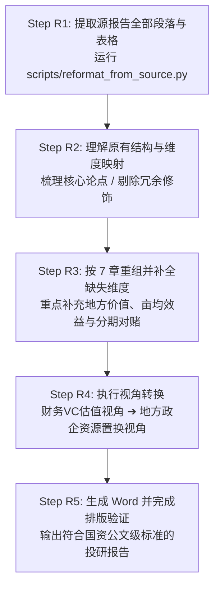

# touyan2 完整端到端工作流操作手册 (WORKFLOW_GUIDE)

> 本文档系统规范 `touyan2` 的两套核心作业流：
> - **模式一：新项目评估标准流（企业商业计划书 BP → 落地投研报告）**
> - **模式二：已有报告重构重组流（券商研报 / 财务 VC 尽调 / Serenity 报告 → 国资 7 章格式）**
> 
> 确保分析师和自动化 Agent 在执行评估时做到步骤不遗漏、证据可溯源、视角不偏差、排版零瑕疵。

---

## 模式一：新项目评估标准流程（6 步完整闭环）

```mermaid
flowchart TD
    S1[Step 1: 源文档读取与分类\ntextutil 转换 / 识别产线落地 vs 纯BP] --> S15[Step 1.5: 投资亮点前置提炼\n4-6 条 Bullet Points / 加粗数据锚点]
    S15 --> S2[Step 2: 7 维度框架结构化分析\n业务判断 / 事实分层 / 财务与落地测算]
    S2 --> S3[Step 3: 生成 Word 报告\nReportGenerator / Python API / CLI]
    S3 --> S4[Step 4: 输出排版核验\n检查文件大小 / 目录 / 标题防孤行 / 边框]
    S4 --> S5[Step 5: 关键数据外部交叉验证 (必做)\n企查查 / 裁判文书 / 行业研报 / 标注 4 态]
    S5 --> S6[Step 6: 出具最终报告与数据说明\n报告末页附公开信息验证底稿]
```

### Step 1：源文档读取与分类识别

1. **源文档文本提取**：
   在 macOS / Linux 环境下，将企业提交的 `.docx` 或 `.doc` 文档提取为纯文本：
   ```bash
   # .docx 转换文本
   textutil -convert txt -stdout "<企业申报材料.docx>" > /tmp/extracted_bp.txt

   # 或通过 Python 脚本提取结构化段落与表格
   python3 scripts/reformat_from_source.py --source "<企业申报材料.docx>" --company "目标企业" --output /tmp/extracted.txt
   ```

2. **文档类型判断标准**：
   - **产线落地类**（包含明确投资总额、厂房面积要求、建设周期、能耗诉求、地方政策/产业基金支持诉求）$\to$ **执行完整 7 章国资招商投研模板**；
   - **纯商业计划书**（仅探讨产品、软件、算法、C端商业模式，无固定资产与实体厂房建设诉求）$\to$ **执行精简版框架**（侧重技术、行业竞争与通用投资风险）。

---

### Step 1.5：核心投资亮点前置提炼（必做）

在展开详细章节前，必须基于全文提炼 **4-6 条核心投资亮点**，置于封面之后的独立第 1 页。

- **编写规范**：
  - 格式采用子弹点：`● **加粗标题**：核心量化数据锚点 + 一句话事实支撑`；
  - 每一条不超过 2 行，按重要性从高到低排列；
  - **第一条必须是行业地位、市场规模或核心技术指标锚点**；
  - 严禁空洞形容词（如“技术实力雄厚”、“发展前景广阔”），必须附带数值（如公差 $\pm 0.015\text{mm}$、良率 $91.5\%$、在手订单 $1.6\text{亿元}$）。

---

### Step 2：7 维度全景框架结构化分析

分析师或 Agent 按照 `SKILL.md` 与 `references/template.md` 逐章展开分析，严格落实**“事实与宣称分离”**：

- **第一章 项目概览**：还原真实总投、自筹比例、分期时间表与资金用途拆解；
- **第二章 行业与市场**：引入至少两家第三方独立权威研报（赛迪、IDC、沙利文等）核验复合增速（CAGR）与竞争格局；
- **第三章 竞争力评估**：绘制 SWOT 矩阵，横向对标关键技术参数（精度、能耗、良率、MTBF）；
- **第四章 财务效益分析**：剔除过高毛利预期，进行压力测试与敏感性测算（原材料 $+10\%$、售价 $-10\%$）；
- **第五章 地方落地价值**：测算亩均固投强度、亩均税收产出、高素质就业吸纳与强链补链效应；
- **第六章 风险分析与缓释**：显式列出技术、供应链、工程延误、对赌履约四大风险及应对措施；
- **第七章 综合评估与建议**：出具综合评分卡、分期投资里程碑触发条件以及投前尽调红旗清单（Red Flags）。

---

### Step 3：生成 Word 报告

将分析好的结构化数据填入 `ReportContent`，调用装配引擎生成规范文档：

```bash
# 命令行方式一键生成
touyan2 generate -d project_data.json -o ./output/产线落地投研报告.docx
```
或者编写 Python 脚本运行：
```python
from touyan2 import ReportContent, generate_report

content = ReportContent(company="目标企业全称")
# 填充 7 章数据...
generate_report(content, "./output/产线落地投研报告.docx")
```

---

### Step 4：排版与格式验证

生成文档后必须进行基础工程核验：
1. **文件大小检查**：确认生成的 `.docx` 大于 30 KB（避免空壳文档）；
2. **版面检查**：
   - 封面要素（标题、副标题、企业名、报告日期、内部使用声明）齐全；
   - 投资亮点页、目录页、免责声明页后均有强制分页；
   - 表格采用深蓝底纹表头（`#1A3C6E`），交替浅色底纹，无跨页生硬截断；
   - 标题与正文设置“与下段同页”，杜绝页面底部的孤行标题。

---

### Step 5：关键数据外部公开信息交叉验证（必做核心）

> ⚠️ **铁律**：严禁无条件采信项目方在商业计划书中的单方自述！

#### 1. 验证范围与核查渠道
- **工商信息**：通过企查查、天眼查、国家企业信用信息公示系统核验成立时间、注册资本、实缴资本、穿透股权结构与实际控制人；
- **历史融资与投资方**：通过 36氪、IT桔子、投资界、公开新闻报道核查历史融资金额、轮次及投资机构全称；
- **重大诉讼与失信记录**：通过中国裁判文书网、执行信息公开网排查是否存在大额借贷诉讼或被执行记录；
- **知识产权与专利**：通过国家知识产权局专利检索系统查验专利有效性、发明人背景及是否存在质押/权属纠纷。

#### 2. 四态核验标记标准

| 标记符号 | 状态定义 | 处理动作 |
| :---: | :--- | :--- |
| ✅ | **已验证** | 公开信息与 BP 完全吻合，采信并注明公开出处 |
| ⚠️ | **部分吻合** | 融资轮次、主体名称或时间存在模糊差异，注明差异细节 |
| ❌ | **有出入** | 公开信息与 BP 明显冲突（如宣称实缴数亿但实缴为零），**必须修正报告正文，并附差异说明** |
| ❓ | **无法验证** | 早期项目未见公开披露，正文严格标注「*项目方声称，待尽调确认*」 |

---

### Step 6：出具最终报告与数据说明

验证完成后，将核验底稿整理为《数据核查与公开信息交叉说明》，追加到 Word 报告尾页：

> **数据说明**：本报告中经营数据及技术指标源自项目方提供的商业计划书。经评估团队外部独立交叉比对：
> - ✅ 注册资本实缴 6,500 万元（国家企业信用信息公示系统可查）；
> - ✅ 历史天使轮由知名国资产业基金领投（公开报道可验证）；
> - ⚠️ 宣传所称年出货量行业第一，经第三方协会口径比对实为特定细分规格第一；
> - ❓ 在手 1.6 亿元供货协议目前为框架备忘录，建议在投前财务尽调中核对银行回单与订单底稿。

---

## 模式二：已有投研报告重构重组流程（5 步转换）

适用场景：已有初步投研报告（如 Serenity 分析、券商研报、咨询顾问材料或内部财务 VC 评审报告），需要快速重组为面向地方政府/国资平台的 7 章招商落地交付标准。



### Step R1：提取源报告内容
运行内置的提取工具：
```bash
python3 scripts/reformat_from_source.py \
  --source "/path/to/源报告.docx" \
  --company "公司名称" \
  --output "/path/to/内容提取与映射模板.txt"
```
工具将自动输出段落索引、表格数据结构及 `assign_content()` 填充空壳。

### Step R2：梳理原有分析框架
理清源报告的核心维度：
- 哪些章节可直接对应（如行业分析、竞争格局）？
- 哪些数据可以复用（如财务报表、产品参数）？

### Step R3 & R4：视角转换与缺失维度补全

**核心转换原则**：

| 分析维度 | 原报告视角（二级市场/财务 VC） | touyan2 转换视角（地方国资招商） |
| :--- | :--- | :--- |
| **投资诉求** | 估值多少倍、未来能否 IPO / 借壳退出 | 真实固投多少、需地方代建多少厂房、用电用水配额 |
| **竞争力评估** | 商业模式变现速度、毛利率是否高企 | 自主可控程度、核心零部件是否受制于人、真实量产良率 |
| **财务分析** | DCF 现金流折现、P/E、P/S 估值倍数 | 投资回收期、保本点产能利用率、原材料及售价敏感性测试 |
| **核心增值（补全）**| 普遍缺失地方效益评估 | **必须补写第五章：亩均税收、产业带动、能耗指标契合度** |
| **决策建议（改写）**| 买入/增持/抛售评级 | **必须改写第七章：分期投资、设备到厂与纳税达标对赌条款** |

### Step R5：装配生成与输出验证
使用 `touyan2` 或 `scripts/gen_report.py` 填充数据并生成 `.docx` 文档，执行排版与数据核查。

---

## 与普通投研（Serenity / 财务 VC）的分工界限

| 比较维度 | 普通二级市场 / 财务 VC 投研 | touyan2 产线落地投研引擎 |
| :--- | :--- | :--- |
| **目标受众** | 股票投资者、公募基金、财务私募 VC | 地方政府招商局、开发区管委会、国资产业基金 |
| **输入材料** | 上市公司财报、券商深度研报、Wind 数据 | 企业商业计划书 (BP)、产线落地申请表、要素诉求函 |
| **研判重心** | 供应链卡点、季度业绩兑现、市盈率估值 | 真实固定资产投资、厂房需求、亩均税收对赌、清算兜底 |
| **输出格式** | Markdown 研报、PDF、PPT 路演材料 | 遵循体制内审阅标准的规范排版 Word 报告 (`.docx`) |
| **最终结论** | 买入 / 增持 / 中性 / 卖出建议 | 建议引进落地 / 审慎附条件推进 / 暂缓或不予支持 |
